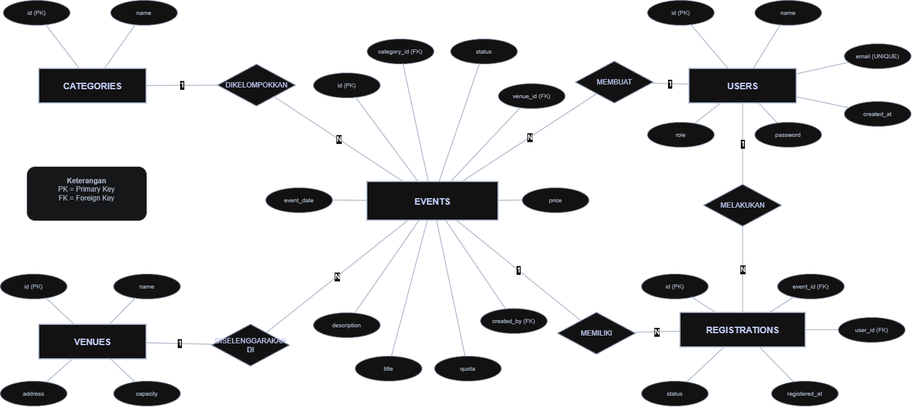
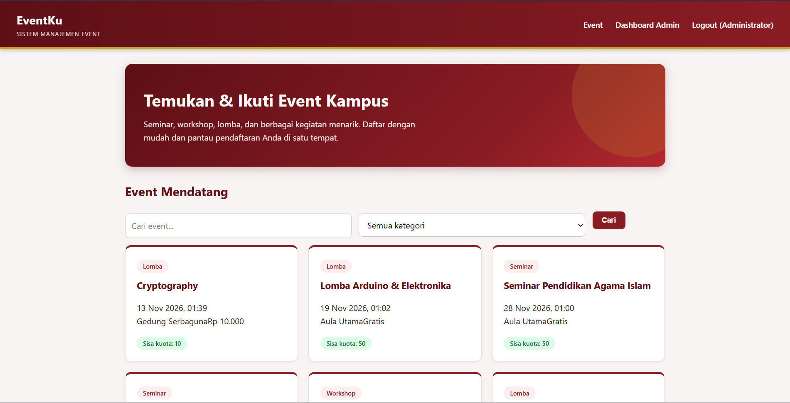
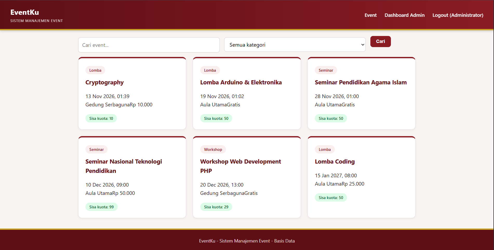
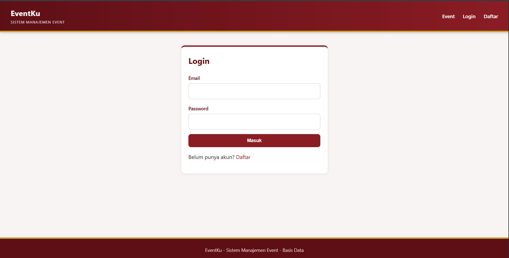
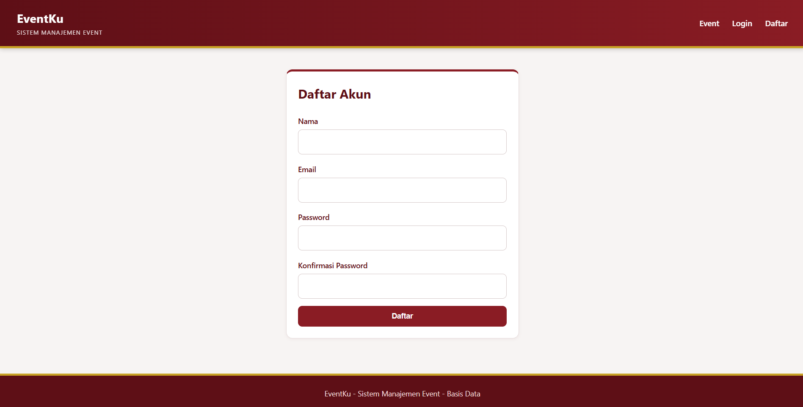
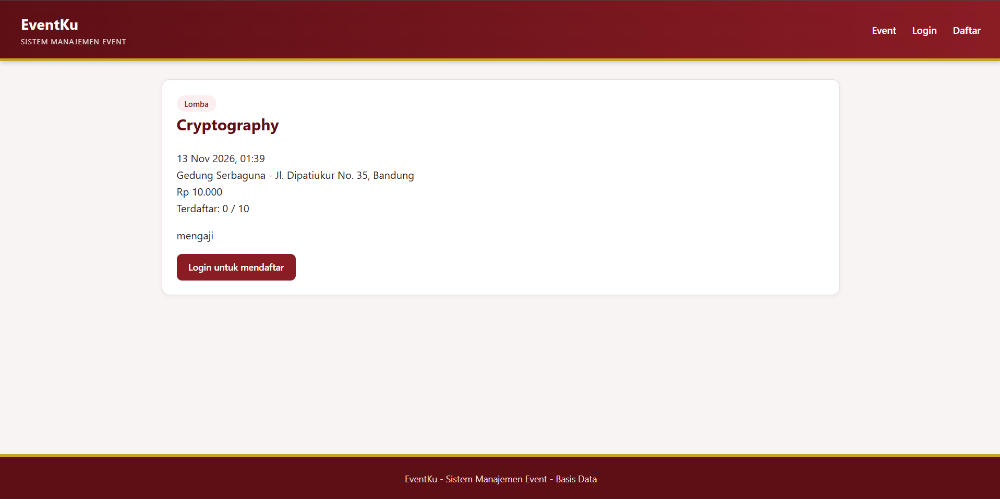
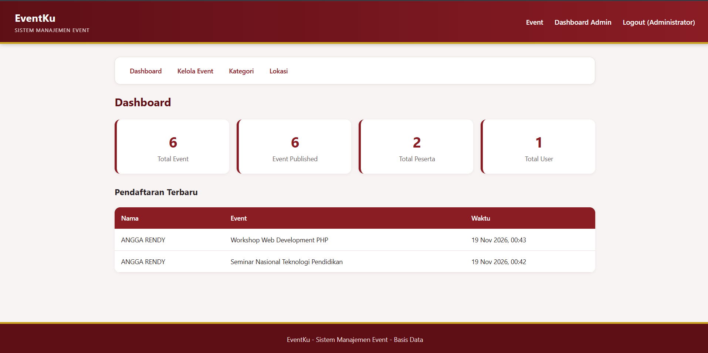
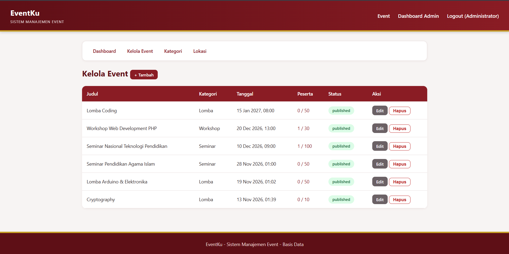
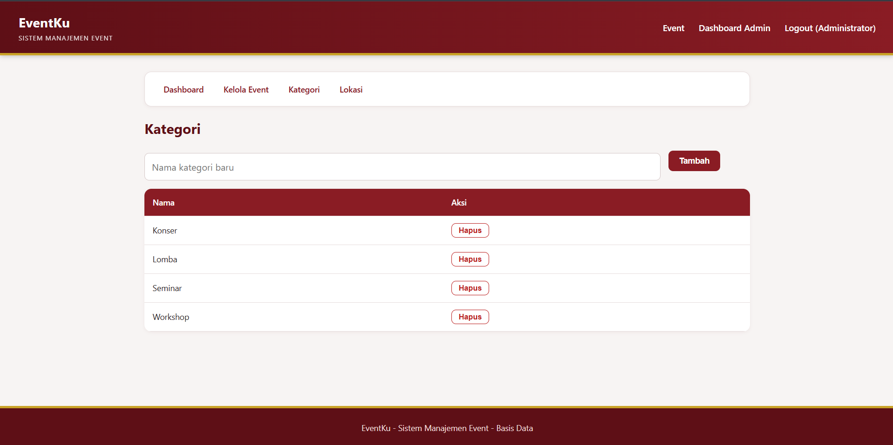
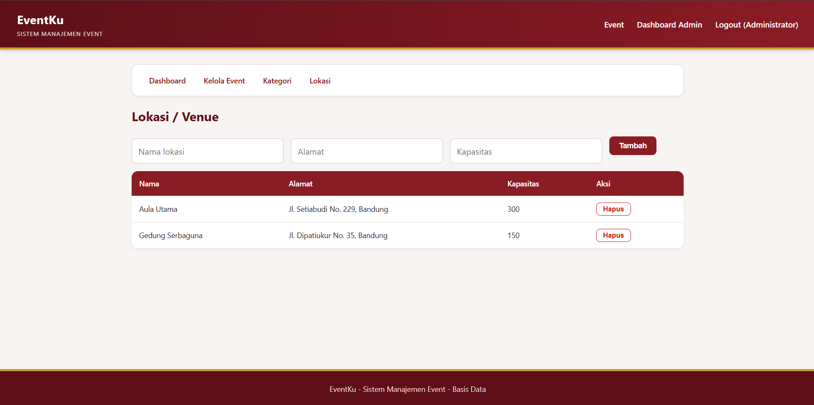

# EventKu - Sistem Manajemen Event

Web manajemen event berbasis **PHP Native** dan **MySQL** (Laragon). Admin dapat mengelola event, kategori, dan lokasi, user dapat melihat event, membuat akun, lalu mendaftar atau membatalkan pendaftaran.

---

## Daftar Isi
1. [Fitur](#fitur)
2. [Teknologi](#teknologi)
3. [ERD dan Struktur Database](#erd-dan-struktur-database)
4. [Cara Instalasi](#cara-instalasi)
5. [Akun Demo](#akun-demo)
6. [Screenshot dan Penjelasan](#screenshot-dan-penjelasan)

---

## Fitur

**Pengunjung dan peserta**
- Melihat daftar event yang berstatus *published*, dengan pencarian judul dan filter kategori
- Melihat detail event (tanggal, lokasi, harga, sisa kuota)
- Registrasi akun dan login
- Mendaftar ke event (dengan validasi kuota) dan membatalkan pendaftaran
- Melihat riwayat pendaftaran

**Admin**
- Dashboard statistik (total event, event published, total peserta, total user)
- CRUD event (tambah, edit, hapus) dengan status *draft*, *published*, *closed*
- Kelola kategori dan lokasi
- Melihat daftar peserta tiap event

## Komponen yang digunakan
| Komponen | Keterangan |
|---|---|
| Bahasa | PHP 8 (native, tanpa framework) |
| Database | MySQL (via Laragon), akses memakai PDO |
| Frontend | HTML, CSS (tema merah marun) |
| Server lokal | Laragon (Apache + MySQL) |

## ERD 



ERD memakai notasi Chen: persegi panjang untuk entitas, oval untuk atribut, dan belah ketupat untuk relasi beserta kardinalitasnya (1 dan N).

| Tabel | Fungsi |
|---|---|
| `users` | Data akun (role `admin` atau `user`) |
| `categories` | Kategori event |
| `venues` | Lokasi penyelenggaraan |
| `events` | Data event (FK ke `categories`, `venues`, `users`) |
| `registrations` | Pendaftaran peserta (menghubungkan `users` dan `events`, kombinasi `event_id` + `user_id` unik) |

**Relasi:** `categories` 1-N `events`, `venues` 1-N `events`, `users` 1-N `events`, `events` 1-N `registrations`, `users` 1-N `registrations`.

## Cara Instalasi

1. Jalankan **Laragon** lalu klik **Start All** (Apache dan MySQL aktif).
2. Clone repository ini ke folder `C:\laragon\www\`:
   ```bash
   cd C:\laragon\www
   git clone https://github.com/AnggaDestara/Tubes-Basis-Data.git event_management
   ```
3. Buka **phpMyAdmin** , lalu import `database.sql`
4. Cek `config/database.php` (default: host `localhost`, user `root`, password kosong).
5. Cek `BASE_URL` di `includes/functions.php` (default `/event_management`, sesuaikan dengan nama folder).
6. Buka `http://localhost/event_management/` di browser.

## Akun Demo
| Role | Email | Password |
|---|---|---|
| Admin | `admin@event.test` | `password` |
| Peserta | Daftar sendiri lewat halaman **Daftar** | - |

---

## Screenshot dan Penjelasan

### 1. Beranda (Daftar Event)


Halaman utama menampilkan banner "Temukan & Ikuti Event Kampus", kolom pencarian judul, dan filter kategori. Di bawahnya, event yang berstatus *published* tampil sebagai kartu yang memuat kategori, judul, tanggal, lokasi, harga, dan sisa kuota. Pada screenshot ini pengguna sedang login sebagai admin, sehingga menu navigasi menampilkan **Dashboard Admin** dan **Logout**.
*File: `index.php`*



Kartu event disusun dalam grid dan diurutkan dari tanggal terdekat. Badge hijau menunjukkan sisa kuota, yang dihitung dari kuota event dikurangi jumlah pendaftaran berstatus `registered`.
*File: `index.php`*

### 2. Login


Pengguna memasukkan email dan password. Sistem memeriksa password dengan `password_verify()`, lalu menyimpan data pengguna di session. Admin diarahkan ke dashboard, sedangkan peserta ke beranda. Tersedia tautan **Daftar** bagi yang belum punya akun.
*File: `login.php`, `logout.php`*

### 3. Registrasi Akun


Pengunjung membuat akun baru dengan mengisi nama, email, password, dan konfirmasi password. Sistem memvalidasi format email, panjang password (minimal 6 karakter), kecocokan konfirmasi password, dan keunikan email. Password disimpan dalam bentuk hash dengan `password_hash()`, dan akun baru otomatis berperan `user`.
*File: `register.php`*

### 4. Detail Event


Halaman detail menampilkan kategori, judul, tanggal, lokasi lengkap dengan alamat, harga, jumlah peserta terdaftar dibanding kuota, dan deskripsi event. Pengunjung yang belum login hanya melihat tombol **Login untuk mendaftar**. Setelah login, tombol berubah menjadi **Daftar Sekarang** (dengan validasi kuota dan status event), dan peserta yang sudah terdaftar dapat membatalkan pendaftarannya.
*File: `event_detail.php`*

### 5. Dashboard Admin


Dashboard menampilkan empat statistik: total event, event published, total peserta, dan total user, serta tabel **Pendaftaran Terbaru** yang memuat nama peserta, event, dan waktu pendaftaran. Menu admin (Dashboard, Kelola Event, Kategori, Lokasi) tersedia di bagian atas. Halaman admin dilindungi `require_admin()`, sehingga peserta biasa tidak dapat membukanya.
*File: `admin/index.php`*

### 6. Kelola Event


Tabel seluruh event beserta kategori, tanggal, jumlah peserta dibanding kuota, dan status (`draft`, `published`, atau `closed`). Admin dapat menambah event lewat tombol **+ Tambah**, mengubah data lewat **Edit**, dan menghapus lewat **Hapus**. Penghapusan memakai metode POST dengan token CSRF dan konfirmasi terlebih dahulu.
*File: `admin/events.php`, `admin/event_form.php`*

### 7. Kelola Kategori


Admin dapat menambah kategori baru lewat kolom di bagian atas dan menghapus kategori lewat tombol **Hapus**. Kategori yang masih dipakai oleh event tidak bisa dihapus karena dijaga oleh foreign key `ON DELETE RESTRICT`, dan sistem akan menampilkan pesan kesalahan.
*File: `admin/categories.php`*

### 8. Kelola Lokasi


Admin dapat menambah lokasi (nama, alamat, dan kapasitas) dan menghapusnya. Aturan penghapusan sama seperti kategori: lokasi yang masih dipakai event tidak dapat dihapus.
*File: `admin/venues.php`*
